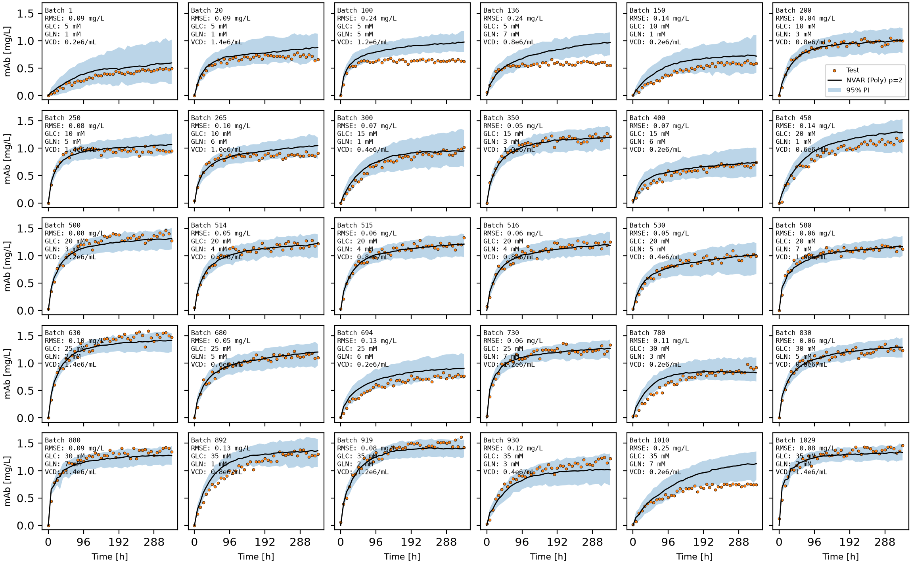
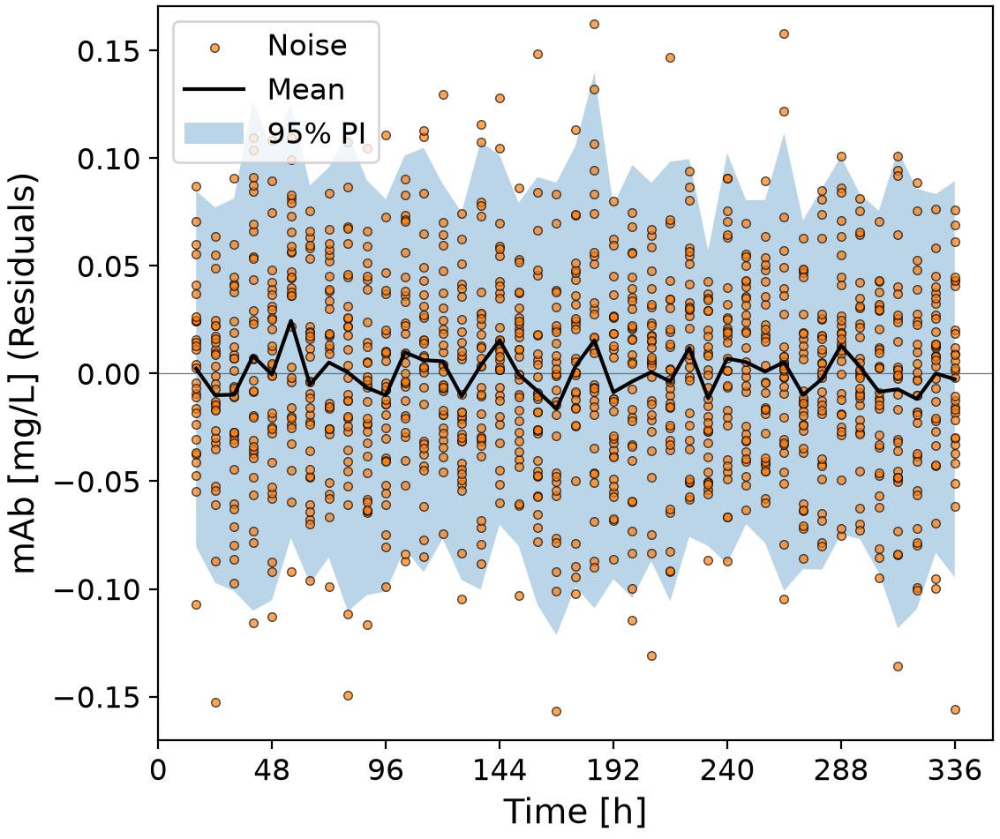
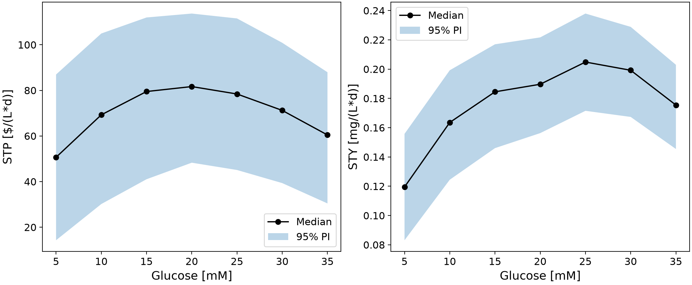
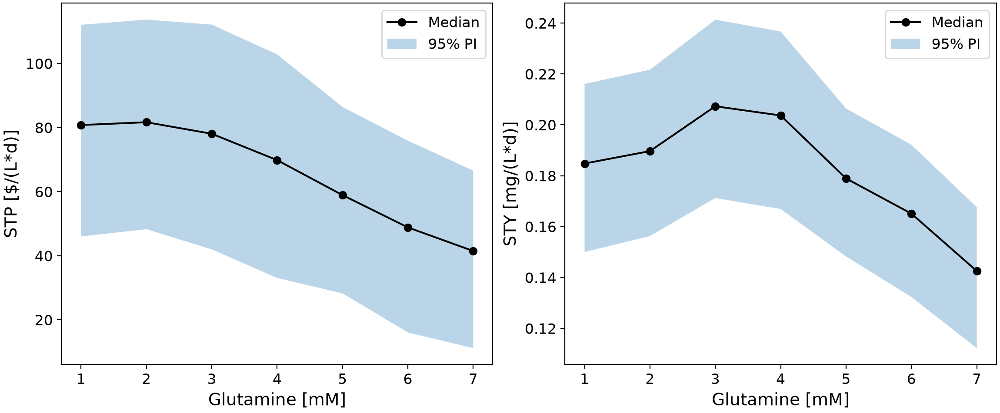
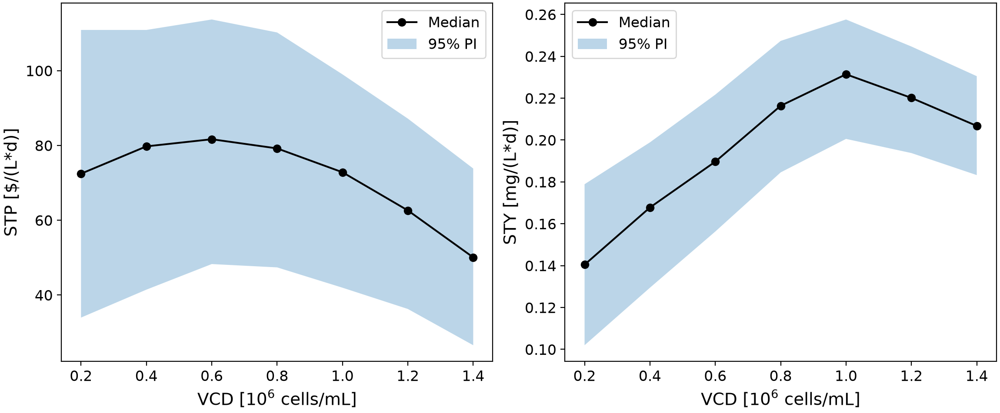
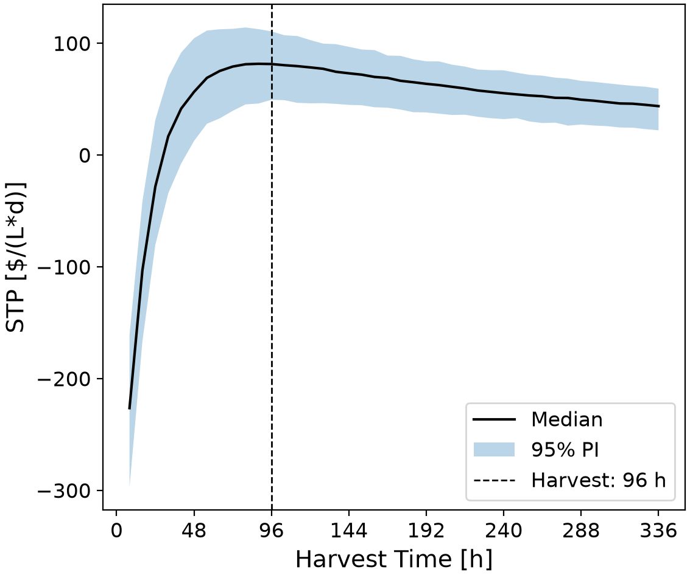

# Monoclonal antibodies profit optimizer

The monoclonal antibodies profit optimizer finds the most ideal batch conditions to create the most optimal bioreactor
possible. Using 30 different batches, it trains time series models that forecast different parameters like glucose, glutamine, lactate, ammonia,
cell density, and antibody concentrations from the starting conditions alone. Then, all the candidate recipes are simulated with uncertainty
to recommend the ideal amount of each parameter that maximizes profit based on time, with 95% predictions intervals.

## Highlights

- Selected 30 batch runs that cover every level of glucose, glutamine and cell density
- Developed linear and nonlinear time series models to forecast full bioreactor batches
- Compared models by forecasting each batch without training on it
- Estimated 95% prediction intervals using 1000 simulations per recipe
- Identified the starting recipe and harvest time that give the highest profit per day

## Environment

- Python 3.14.7
- Matplotlib x.y.z
- NumPy x.y.z
- pandas x.y.z
- scikit-learn x.y.z
- SciPy x.y.z

## Code design

Running main.py executes the full workflow, from raw batch files to a recommended operating recipe. main.py contains no 
modelling logic of its own: it calls functions from src/functions.py, the scaler and model classes in src/classes.py, and 
settings from src/constants.py. Every figure is saved to figures/ and every table to tables/, so each run leaves a complete 
record of the analysis.

### Configuration

All the values that stay constants are defined in constants.py, to ensure that if certain parameters want to be changed, they can
be easily be changed in that one file. More importantly, the random seed is fixed so that every singe simulation can be reproducible
so that changing different parameters can be compared with the same seed, making results more interpretable.

### Data loading

Every single batch is stored in a csv file in datasets. While each batch contains time 672 hours, only the first 336 hours are kept
since the antibody production is more optimal at this stage (will be proven later). The initial conditions are also read from datasets,
so that the initial conditions for each batch ID can be easily compared to the timed data, and thus optimized for profit.

### Lagged-values

Time series models predict the next state of a batch from its previous states. Each batch is therefore converted into pairs 
of inputs, the values of all seven process variables at the previous p time points, and outputs, the values of the same 
variables at the current time point. This conversion is done separately for each batch, so the previous state of one batch 
is never treated as if it came before the first state of another.

### Models

Three model types are built as scikit-learn pipelines, all starting with a custom scaler that standardizes each process 
variable with one mean and standard deviation shared by all of its lagged copies. This keeps variables on very different 
scales (VCD near 10^6 cells/mL, antibody near 1 mg/L) comparable while treating each lag of the same variable identically.
The first model is a linear vector autoregressive (VAR) model. The second is a nonlinear VAR (NVAR) model that adds polynomial 
and interaction terms before the linear regression. The third is an NVAR model that uses k-nearest neighbors regression. 
Hyperparameters (polynomial degree, number of neighbors) are tuned with a grid search whose folds keep each batch whole, 
so tuning never scores a model on time points from a batch it trained on.

### Forecasting with uncertainty

A new batch only has known initial conditions, so a forecast is built iteratively: the model predicts the next time point, 
the prediction becomes an input for the step after, and so on until the horizon. To represent the variability seen between 
real batches, each step adds white noise sampled from the model's training residuals, separately for each variable. Predictions 
are kept within the range seen during training and above zero. Repeating the forecast many times produces a distribution of 
possible batches, whose median is the forecast and whose 2.5th and 97.5th percentiles form the 95% prediction interval. All 
simulations are advanced side by side in a single array, which makes thousands of forecasts fast enough to run in minutes.

### Comparing models

Each model type is evaluated for p = 1, 2, and 3 with leave-one-batch-out cross-validation: one batch is held out, the model 
is trained and tuned on the other 29, and the held-out batch is forecast from its initial conditions alone. This mirrors 
exactly how the model is later used, forecasting a recipe that has never been run. The forecast antibody concentration is 
compared with the measurements using the root mean squared error (RMSE), and the fraction of measurements inside the 95% 
interval is recorded. The model with the lowest mean RMSE is selected and retrained on all 30 batches. Its residuals are 
then checked for white-noise behaviour, since the uncertainty estimate assumes the noise has no trend over time.

### Optimization

The selected model forecasts all 343 (from the 7 possible values for the 3 different starting conditions) 
combinations of the seven tested levels of glucose, glutamine, and VCD, with 1000 
simulations each. Restricting the search to tested levels keeps it inside the range the model has learned. For every 
simulation, the cost, value, profit, STP, and space-time yield (STY) are calculated at every possible harvest time, 
including the one day of downtime. The harvest time with the highest median STP is kept for each combination, and the 
combinations are ranked. The best recipe is then simulated again with a fresh set of 1000 forecasts, so its reported 
intervals are not taken from the same simulations used to select it.

### Interpretation

Finally, each initial condition is varied across its levels while the other two are held at their recommended values. 
This shows how glucose, glutamine, and VCD individually affect STP and STY, and why the recommended recipe is where it is.

## Analysis

### Choice of batches

The candidate batches cover seven levels each of initial glucose (5 to 35 mM), glutamine (1 to 7 mM), and VCD (0.2 to 1.4 × 10^6 
cells/mL), or 343 combinations in total. With only 30 runs, the goal was to spread them across this space so that the model sees every
region it will later be asked to forecast. The table_01 demonstrates that the batches selected are meant to follow a space-filling design.
This is done to ensure that all the conditions are tested, even at the extremes. Also, the center point is run 3 times because identical recipes
show how much batches can vary from natural noise alone.

### Choice of model

All three model types predict all seven process variables at once. The cells need glucose and glutamine to grow, they produce 
lactate and ammonia as waste, and the living cells are what make the antibody. Tracking all of these tells the model where 
the batch is heading. A model that only followed the antibody would miss this information.

| Model | *p* | Forecast RMSE [mg/L] | Measurements inside 95% PI | Tuned hyperparameter |
|---|---:|---:|---:|---|
| VAR | 1 | 0.176 ± 0.082 | 84% | — |
| VAR | 2 | 0.169 ± 0.075 | 76% | — |
| VAR | 3 | 0.178 ± 0.068 | 71% | — |
| NVAR (Poly) | 1 | 0.130 ± 0.086 | 88% | degree = 2 |
| **NVAR (Poly)** | **2** | **0.099 ± 0.056** | **88%** | **degree = 2** |
| NVAR (Poly) | 3 | 0.137 ± 0.154 | 90% | degree = 2 |
| NVAR (kNN) | 1 | 0.223 ± 0.132 | 55% | k = 16 |
| NVAR (kNN) | 2 | 0.217 ± 0.136 | 50% | k = 18 |
| NVAR (kNN) | 3 | 0.219 ± 0.125 | 51% | k = 20 |

The table_04 above shows the different error values for the different models. The selected model is a polynomial NVAR model of degree 2 with p = 2. It had the smallest forecast error of all the models 
tested: 0.099 mg/L, while batches usually end with about 1 to 1.4 mg/L of antibody. The grid search picked degree 2 over degree
3 in all 30 training rounds. Squared terms are the simplest way to draw a curve that levels off, like production slowing down 
when glucose runs out or ammonia builds up. Degree 3 adds far more terms than 29 batches can reliably support. Using p = 2 means
the model sees both the current state of the batch and the direction it is moving in. Adding a third time point (p = 3) made 
the error larger and less consistent, because it added more terms without adding much new information.

Each panel above is a batch the model never saw, forecast from its three initial conditions alone. 
The median forecast follows the measured shape closely for most batches, including the rapid early rise and the plateau.

### Comparison with alternative models

The linear VAR model cannot represent the plateau properly: it treats every effect as proportional, while antibody production 
slows down as nutrients are consumed. Its error is about 70% higher than the polynomial NVAR, and its prediction intervals
miss more measurements as p increases.

The kNN NVAR model performed worst. It predicts the next state by averaging the most similar states in the training data, 
but a forecast starts from initial conditions where only 29 states exist, one per training batch, so the neighbours are often 
batches with quite different recipes. The grid search also chose large neighbourhoods (k = 16 to 20), which smooths the 
forecasts toward the average batch and makes it poor at separating good recipes from bad ones. Only about half of the 
measurements fell inside its intervals.

Both of these performances can be observed in the two plots:
[figure_03_cv_forecasts_var_p02.png](figures/figure_03_cv_forecasts_var_p02.png) 
and [figure_03_cv_forecasts_knn_p02.png](figures/figure_03_cv_forecasts_knn_p02.png).

### Advantages and limitations

#### Advantages

- It forecasts an entire 14-day batch from only three inputs, so any recipe can be screened before it is run.
- It is compact and transparent: a quadratic expansion of the 14 lagged inputs fitted by ordinary least squares.
- It gives a full distribution of outcomes rather than a single number, so recipes can be compared on risk as well as on expected profit.
- Its residuals behave like white noise: their mean stays near zero at every time point, with no trend over the batch.

#### Limitations

- As demsontrated in the figure above, the intervals are somewhat too narrow. Only about 88% of the held-out measurements 
fall inside the 95% prediction intervals. 
The noise is sampled from training residuals, which are smaller than the errors on unseen batches, so the true uncertainty 
is larger than shown.
- Forecast errors are largest for unusual recipes. The worst forecasts were for low glucose with high glutamine 
(batches 100 and 136) and for high glucose with high glutamine and low VCD (batch 1010), where the model overpredicted 
antibody. Few batches lie in these regions, which fortunately are also unprofitable.
- The model is conservative at the center point. It predicts a maximum median STP of 66 $/(L·d) for the triplicate condition,
while the three measured runs reached 86 to 92 $/(L·d). Part of this gap is noise, since a 
single high measurement early in the batch strongly raises the measured STP, but it shows that the model tends to smooth peaks.
- The recommended recipe has not been tested. Each of its levels was tested, but not this combination.

### Influence of initial conditions

The figures below vary one condition at a time, with the other two at their recommended values.

#### Effect of glucose

Glucose has an optimum. At 5 mM, the cells run out of their main energy source and the median STP drops to 51 $/(L·d), with 
an STY of only 0.12 mg/(L·d). Raising glucose increases antibody production up to about 25 to 30 mM, where STY levels off at 
0.20 mg/(L·d). Beyond 20 mM, however, each extra 5 mM costs $50/L while adding less and less antibody, so STP peaks at 20 mM 
(82 $/(L·d)) and falls to 60 $/(L·d) at 35 mM.

#### Effect of glutamine

Glutamine has the strongest effect. It is the most expensive input per mM and is broken down into ammonia, which inhibits 
the cells. STP stays near 80 $/(L·d) from 1 to 3 mM, then falls steadily to 41 $/(L·d) at 7 mM. STY peaks at 3 mM 
(0.21 mg/(L·d)), showing that a small amount helps production while more becomes harmful.

#### Effect of VCD

Initial VCD shows the clearest difference between yield and profit. More cells at the start produce antibody sooner: 
STY rises from 0.14 mg/(L·d) at 0.2 × 10^6 cells/mL to 0.23 mg/(L·d) at 1.0 × 10^6 cells/mL. But the inoculum is the 
largest cost in the recipe ($100/L per 0.2 × 10^6 cells/mL), so STP peaks at 0.6 × 10^6 cells/mL and falls to 50 $/(L·d) at 
1.4 × 10^6 cells/mL.

Based on these results, maximizing yield and maximizing profit lead to different recipes. The highest median STY (0.28 mg/(L·d)) 
comes from 30 mM glucose, 3 mM glutamine, and 1.2 × 10⁶ cells/mL, but that recipe costs $960/L and earns only 55 $/(L·d). 
The most profitable recipes use moderate amounts of every input.

### Recommended Operating conditions

The STP is strongly negative for early harvests, since the full cost is paid but little antibody has been made. It rises 
quickly, peaks at about 4 days, then declines slowly because the titre plateaus while each extra day adds to the cycle time. 
Harvesting late is therefore much less costly than harvesting early.

| Quantity | Recommended value |
|---|---|
| Initial glucose | **20 mM** |
| Initial glutamine | **2 mM** |
| Initial VCD | **6.0 × 10⁵ cells/mL** |
| Harvest time | **4.0 d** (96 h) |
| Cell culture cost | **540 $/L** |
| Cell culture value at harvest | **947 $/L** (95% PI: 787 to 1093) |
| Space-time profit | **81.4 $/(L·d)** (95% PI: 49.4 to 110.6) |
| mAb space-time yield | **0.189 mg/(L·d)** (95% PI: 0.157 to 0.219) |

The full ranking is in [table_05_optimization_all_conditions.csv](tables/table_05_optimization_all_conditions.csv), 
and the final values are in [table_06_recommendation.csv](tables/table_06_recommendation.csv).

The optimum is flat. The ten best recipes all lie within about 4 $/(L·d) of each other, far less than the width of the 
prediction interval, and they share the same pattern: 15 to 25 mM glucose, 1 to 3 mM glutamine, 0.4 to 0.8 × 10^6 cells/mL, 
and a harvest after 3.3 to 4.3 days. The recipe is therefore robust: small deviations in the medium or the inoculum cost 
little profit. Because the recommended combination was never run and the model is conservative near the center point, 
the next step would be to run a few confirmation batches at this recipe alongside the center condition, and to add the 
results to the training data.